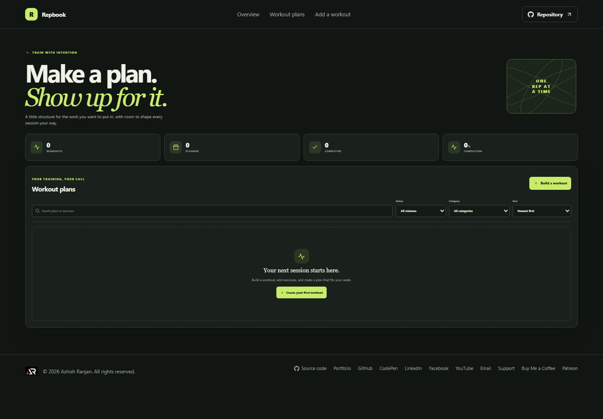

# Repbook: Workout Planner

Repbook is a personal space to shape training sessions, keep exercise details together, and track which plans you have completed. Your workouts stay in this browser, so you can plan without creating an account.

**Project repository:** https://github.com/a2rp/workout-planner
**Deployed site:** https://a2rp.github.io/workout-planner/

## What you can do

- Create and edit workouts with a date, category, duration, status, and notes.
- Add multiple exercises with sets, reps, weight, and time.
- Mark plans as completed or planned, and duplicate a workout for another day.
- Search workout and exercise names, filter by category or status, and sort the list.
- Review total, planned, and completed workouts with a completion rate.
- Remove a workout with a confirmation dialog.

## How to use it

Choose **Build a workout**, enter the session details, and add any exercises you want to keep together. Save the session as planned or completed. Use the workout library controls to search, filter, and sort the plans. You can edit, duplicate, change status, or remove any saved workout.

## Data and privacy

Workout details are stored in local storage in this browser. Earlier workout records from this app are migrated when Repbook first opens. Data is not sent to a server, and clearing browser site data removes saved workouts. Repbook is a planning log and does not provide individualized training or medical advice.

## Run and check locally

Install dependencies with `npm install`, then start the Vite development server with `npm run dev`. Run `npm run lint` for ESLint and `npm run build` for a production build. Run `npm run deploy` to publish the `dist` folder to the `gh-pages` branch.

## Future improvements

Ideas only. These are not implemented yet:

- Add reusable workout templates.
- Add optional weekly volume and personal record summaries.
- Add exercise tags and equipment filters.

## Links

- Portfolio: [https://www.ashishranjan.net](https://www.ashishranjan.net)
- GitHub: [https://github.com/a2rp](https://github.com/a2rp)
- CodePen: [https://codepen.io/ash1198](https://codepen.io/ash1198)
- LinkedIn: [https://www.linkedin.com/in/aashishranjan](https://www.linkedin.com/in/aashishranjan)
- Facebook: [https://www.facebook.com/theash.ashish/](https://www.facebook.com/theash.ashish/)
- YouTube: [https://www.youtube.com/@ashishranjan-ashz?sub_confirmation=1](https://www.youtube.com/@ashishranjan-ashz?sub_confirmation=1)
- Email: [mailto:ash.ranjan09@gmail.com](mailto:ash.ranjan09@gmail.com)

## Support

- Support: [https://a2rp-donation-page.netlify.app/](https://a2rp-donation-page.netlify.app/)
- Buy Me a Coffee: [https://buymeacoffee.com/ashishranjan](https://buymeacoffee.com/ashishranjan)
- Patreon: [https://www.patreon.com/ashishranjan](https://www.patreon.com/ashishranjan)
